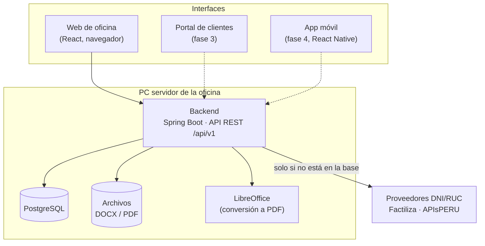
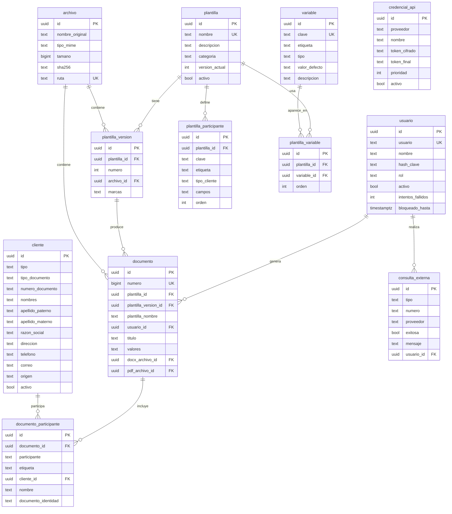
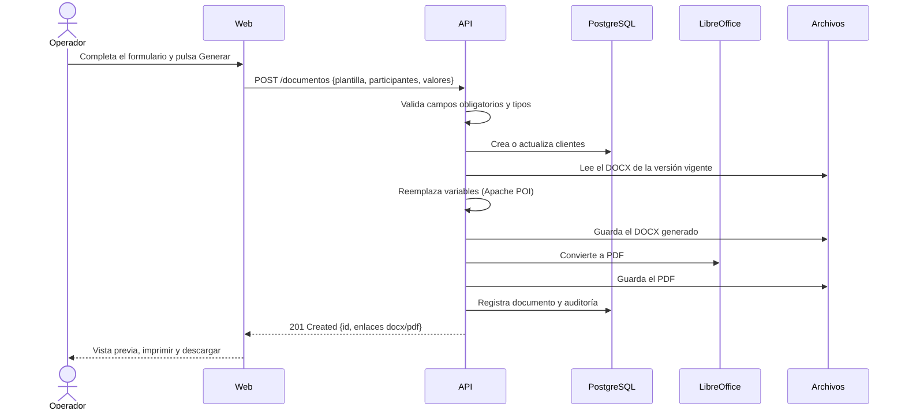

# Arquitectura — Estudio Documental v2

> **Estado:** fases 0 y 1 implementadas (ver [hoja de ruta](#18-hoja-de-ruta)) · **Última actualización:** 14 de noviembre de 2026
> **Reemplaza a:** la aplicación de escritorio JavaFX + SQLite (v1), conservada en la rama `v1` (ver su `CONTEXTO.md`).

Este documento define cómo se va a construir la nueva versión: qué tecnologías se usan y por qué, cómo se organiza el código, cómo es la base de datos y en qué orden se construye. Es la referencia para tomar decisiones; si algo cambia, se actualiza aquí primero.

---

## Índice

1. [Propósito y alcance](#1-propósito-y-alcance)
2. [Usuarios y casos de uso](#2-usuarios-y-casos-de-uso)
3. [Decisiones de arquitectura](#3-decisiones-de-arquitectura)
4. [Vista general](#4-vista-general)
5. [Stack tecnológico](#5-stack-tecnológico)
6. [Backend](#6-backend)
7. [Convenciones de la API](#7-convenciones-de-la-api)
8. [Base de datos](#8-base-de-datos)
9. [Generación de documentos](#9-generación-de-documentos)
10. [Consultas DNI/RUC](#10-consultas-dniruc)
11. [Seguridad y datos personales](#11-seguridad-y-datos-personales)
12. [Frontend](#12-frontend)
13. [Estructura del repositorio](#13-estructura-del-repositorio)
14. [Instalación en la oficina](#14-instalación-en-la-oficina)
15. [Respaldos](#15-respaldos)
16. [Calidad y forma de trabajo](#16-calidad-y-forma-de-trabajo)
17. [Qué se reutiliza de la v1](#17-qué-se-reutiliza-de-la-v1)
18. [Hoja de ruta](#18-hoja-de-ruta)
19. [Preguntas abiertas](#19-preguntas-abiertas)
20. [Glosario](#20-glosario)

---

## 1. Propósito y alcance

**Problema.** En un negocio tipo notaría se redactan a diario documentos con la misma estructura (declaraciones juradas, cartas poder, contratos, solicitudes) cambiando solo los datos de las personas. Hacerlo a mano en Word es lento y propenso a errores de tipeo en nombres, DNI y direcciones.

**Solución.** Un sistema donde el personal elige una plantilla Word, identifica a los participantes por DNI/RUC (los datos se completan solos) y obtiene el documento listo para imprimir en Word y PDF, con historial de todo lo generado.

**Alcance de la v2 (oficina):**

- Usuarios con contraseña y roles.
- Plantillas Word con variables `{{...}}`, versionadas.
- Registro de clientes (personas y empresas) reutilizable.
- Consulta de DNI/RUC: primero en la base local y luego en proveedores externos.
- Generación de DOCX y PDF, impresión e historial.
- Auditoría y respaldos.

**Fuera de alcance por ahora (diseñado para agregarse después):** portal web para clientes finales, app móvil, pagos, firma digital, varias sedes.

---

## 2. Usuarios y casos de uso

| Rol | Quién es | Qué hace |
|---|---|---|
| `ADMIN` | Dueño o encargado | Todo lo del operador, más: gestionar usuarios, plantillas, credenciales de API, respaldos y auditoría |
| `OPERADOR` | Personal de atención | Buscar o registrar clientes, generar documentos, reimprimir del historial |
| `CLIENTE` *(fase 3)* | Persona que hace su propio trámite | Llenar sus datos en el portal o la app y generar o solicitar su documento |

**Caso principal: generar un documento**

1. El operador elige la plantilla (por ejemplo, "Carta poder simple").
2. El sistema muestra el formulario con los campos de la plantilla, agrupados por participante (otorgante, apoderado…).
3. Por cada participante, el operador escribe el DNI/RUC; el sistema busca en clientes locales y, si no existe, consulta el proveedor externo.
4. El operador completa o corrige los campos restantes.
5. El sistema genera el DOCX y el PDF, guarda el documento en el historial y crea o actualiza los clientes.
6. El operador imprime o descarga.

---

## 3. Decisiones de arquitectura

Cada decisión indica la alternativa descartada y el motivo, para no volver a discutirla sin información nueva.

| # | Decisión | Alternativa descartada | Motivo |
|---|---|---|---|
| D1 | **Aplicación web con API** (backend + navegador) | Escritorio JavaFX (v1) | Varias PCs comparten datos; el mismo backend sirve después al portal y a la app móvil |
| D2 | **Monolito modular** (un solo backend dividido en módulos) | Microservicios | Un equipo pequeño y una sola oficina no justifican la complejidad operativa; los módulos se pueden separar luego si hiciera falta |
| D3 | **Java 21 + Spring Boot 4** | Node.js, Python | Experiencia previa del equipo en Java; Apache POI es la librería más completa para DOCX; Spring cubre seguridad, validación y datos |
| D4 | **PostgreSQL** | SQLite (v1), MySQL | SQLite no admite bien varios usuarios simultáneos ni un servidor; PostgreSQL es gratuito, corre igual en la oficina y en la nube, y tiene `jsonb` para datos flexibles |
| D5 | **Migraciones con Flyway** | Crear tablas desde el código (v1) | Cada cambio de la base queda versionado, revisable y se aplica igual en todas las instalaciones |
| D6 | **Plantillas diseñadas en Microsoft Word** | Editor propio dentro de la app (v1) | Formato 100 % fiel y mucho menos código que mantener; el editor propio era la parte más compleja y frágil de la v1 |
| D7 | **PDF con LibreOffice sin interfaz** | OpenPDF (v1) | OpenPDF redibuja el documento y pierde formato (tablas complejas, viñetas, fuentes); LibreOffice lo convierte tal cual |
| D8 | **Archivos en disco, metadatos en la base** | Archivos como BLOB en la base (v1) | La base se mantiene liviana y los respaldos son más rápidos; el almacenamiento queda detrás de una interfaz para pasar a la nube (S3/MinIO) sin cambiar el resto |
| D9 | **React + TypeScript** | Angular, Vue, JavaFX | El más extendido; el conocimiento se reutiliza en la app móvil con React Native |
| D10 | **Autenticación con JWT** | Sesión con cookie | Un solo mecanismo para web, portal y móvil |
| D11 | **Desarrollo sin Docker; Docker Compose opcional para instalar** | Docker obligatorio | El equipo trabaja con PostgreSQL instalado en Windows y pgAdmin. Docker queda como forma rápida de instalar en un servidor; no cambia el costo de hospedaje |

---

## 4. Vista general



- **Sin internet el sistema funciona**, salvo la consulta a proveedores externos.
- Hoy todo corre en **una PC de la oficina** y las demás entran desde el navegador (`http://servidor:8080`).
- Para el portal y la app, el mismo backend se publica en un servidor en internet. No se reescribe nada, solo se agregan las nuevas interfaces y el rol `CLIENTE`.

---

## 5. Stack tecnológico

Versiones fijadas en la fase 0 (noviembre de 2026). Las exactas están en `backend/pom.xml` y `frontend/package.json`.

| Capa | Tecnología | Uso |
|---|---|---|
| Lenguaje backend | Java 21 (LTS) | |
| Framework | Spring Boot 4.1: Web MVC, Validation, Security (OAuth2 Resource Server para JWT), Data JPA, Actuator | API, validación, seguridad, acceso a datos, salud del sistema |
| Base de datos | PostgreSQL 17 | Datos del sistema |
| Migraciones | Flyway | Versionado de la base |
| Documentos | Apache POI (`poi-ooxml`) | Leer plantillas y reemplazar variables |
| PDF | LibreOffice headless (`soffice --convert-to pdf`) | Conversión fiel |
| Documentación API | springdoc-openapi 3 | Swagger UI en `/api/docs` |
| Formato backend | Spotless (Palantir Java Format) | `./mvnw spotless:apply` |
| Pruebas backend | JUnit 5, AssertJ, MockMvc contra PostgreSQL real (base `estudio_documental_test`) | |
| Lenguaje frontend | TypeScript | |
| Framework web | React 19 + Vite 8 | |
| UI | MUI 9 (Material UI) | Componentes listos y accesibles |
| Rutas | React Router | Navegación y rutas protegidas |
| Datos en el frontend | TanStack Query + cliente HTTP propio (`src/api/cliente.ts`) | Llamadas a la API; en la fase 1 se generarán los tipos desde OpenAPI |
| Formularios | React Hook Form + Zod | Formularios y validación |
| Pruebas frontend | Vitest, Testing Library; Playwright (E2E) desde la fase 1 | |
| Calidad frontend | oxlint + Prettier | Revisión y formato automáticos |
| Infraestructura | Docker Compose (opcional) | Instalación en servidor con un comando |
| CI | GitHub Actions | Compilar y probar cada PR |

---

## 6. Backend

### 6.1 Módulos

El backend se organiza **por módulo de negocio**, no por tipo de clase. Cada módulo es dueño de sus tablas y expone un servicio público; los demás módulos solo usan ese servicio, nunca sus repositorios ni sus entidades.

| Módulo | Responsabilidad |
|---|---|
| `identidad` | Usuarios, roles, login, JWT |
| `clientes` | Personas y empresas; búsqueda y deduplicación |
| `plantillas` | Subir DOCX, detectar variables, versiones, categorías |
| `variables` | Catálogo compartido de variables (`dni`, `nombres`, `direccion`…) y su tipo |
| `documentos` | Generar DOCX/PDF, historial, regenerar |
| `consultas` | DNI/RUC: caché local y proveedores externos con respaldo |
| `archivos` | Guardar y leer archivos (disco hoy, nube mañana) |
| `auditoria` | Registro de quién hizo qué y cuándo |
| `comun` | Errores, utilidades, configuración compartida |

### 6.2 Capas dentro de cada módulo

```
clientes/
├── api/              Controladores REST y DTOs (lo que entra y sale en JSON)
├── aplicacion/       Servicios: casos de uso y transacciones
├── dominio/          Entidades y reglas de negocio
└── infraestructura/  Repositorios JPA, clientes HTTP, integraciones
```

**Reglas:**

1. Los controladores no tienen lógica: validan la entrada, llaman a un servicio y devuelven un DTO.
2. Las entidades JPA nunca salen por la API; siempre se convierten a DTO.
3. Las transacciones (`@Transactional`) van en los servicios de `aplicacion`.
4. Las integraciones externas (proveedores DNI/RUC, LibreOffice, disco) se usan a través de una interfaz definida por el módulo; la implementación vive en `infraestructura`. Así se pueden cambiar o simular en pruebas.
5. Un módulo no accede a las tablas de otro.
6. Toda la configuración (URL de la base, rutas, claves) viene de variables de entorno, nunca escrita en el código.

### 6.3 Paquete base

`pe.estudiodocumental` (provisional, ver [preguntas abiertas](#19-preguntas-abiertas)). Reemplaza al `com.ejemplo.crudpersona` de la v1.

---

## 7. Convenciones de la API

| Tema | Convención |
|---|---|
| Base | `/api/v1/...`; una versión nueva solo si se rompe la compatibilidad |
| Recursos | Sustantivos en plural y en español: `/clientes`, `/plantillas`, `/documentos` |
| Formato | JSON; fechas en ISO 8601 con zona (`2026-11-14T10:30:00-05:00`) |
| Identificadores | UUID, para no exponer cantidades y para que el portal y la app puedan crear registros sin chocar |
| Errores | Formato estándar *Problem Details* (RFC 9457): `type`, `title`, `status`, `detail` y la lista de campos inválidos |
| Paginación | `?page=0&size=20&sort=apellidos,asc`; la respuesta incluye el total |
| Validación | Anotaciones Bean Validation en los DTO; mensajes en español |
| Documentación | Swagger UI en `/api/docs`, generada desde el código |

**Endpoints implementados** (detalle y pruebas en vivo en `/api/docs`):

```
POST   /api/v1/auth/login                     Público
GET    /api/v1/auth/yo                        Usuario dueño del token
PUT    /api/v1/auth/clave                     Cambiar la propia contraseña

GET    /api/v1/clientes?q=&pagina=&tamano=    Búsqueda por documento (inicio) o nombre (contiene)
GET    /api/v1/clientes/documento/{tipo}/{n}  404 si no está en la base local
GET    /api/v1/clientes/{id}
POST   /api/v1/clientes
PUT    /api/v1/clientes/{id}
DELETE /api/v1/clientes/{id}                  ADMIN · baja lógica

GET    /api/v1/variables
POST   /api/v1/variables                      ADMIN
PUT    /api/v1/variables/{id}                 ADMIN · la clave no cambia

GET    /api/v1/plantillas?soloActivas=
GET    /api/v1/plantillas/{id}                Con participantes, variables y versiones
POST   /api/v1/plantillas                     ADMIN · multipart (archivo, nombre, categoria, descripcion)
POST   /api/v1/plantillas/{id}/versiones      ADMIN · multipart (archivo)
PUT    /api/v1/plantillas/{id}                ADMIN · datos y configuración de participantes
GET    /api/v1/plantillas/{id}/versiones/{n}/docx

POST   /api/v1/consultas/{DNI|RUC}/{n}?actualizar=   Clientes primero; luego proveedores
GET    /api/v1/credenciales                   ADMIN · con consultas del mes
POST   /api/v1/credenciales                   ADMIN
PUT    /api/v1/credenciales/{id}              ADMIN
DELETE /api/v1/credenciales/{id}              ADMIN

POST   /api/v1/documentos                     Generar
GET    /api/v1/documentos?q=&desde=&hasta=    Historial
GET    /api/v1/documentos/{id}
GET    /api/v1/documentos/{id}/docx
GET    /api/v1/documentos/{id}/pdf?verEnLinea=
GET    /api/v1/documentos/estado-pdf

GET    /api/v1/usuarios                       ADMIN
POST   /api/v1/usuarios                       ADMIN
PUT    /api/v1/usuarios/{id}                  ADMIN
PUT    /api/v1/usuarios/{id}/clave            ADMIN · restablece y desbloquea
```

---

## 8. Base de datos

### 8.1 Reglas

- Nombres en español, en `snake_case` y en singular: `cliente`, `plantilla_version`.
- Toda tabla tiene `id uuid`, `creado_en` y `actualizado_en` (`timestamptz`).
- Los cambios se hacen **solo** con migraciones Flyway (`V001__crear_identidad.sql`, `V002__...`). Una migración aplicada nunca se modifica: se crea una nueva.
- Borrado lógico (`activo = false`) en clientes, plantillas y usuarios, para no romper el historial.
- Los archivos no van en la base: se guarda la ruta, el tamaño y el hash SHA-256.

### 8.2 Modelo (implementado, migraciones V001 a V008)



Todas las tablas tienen además `creado_en` y `actualizado_en`.

### 8.3 Tablas clave

| Tabla | Notas |
|---|---|
| `usuario` | `rol` = `ADMIN` u `OPERADOR`. Se bloquea 15 minutos tras 5 intentos fallidos |
| `cliente` | Único por (`tipo_documento`, `numero_documento`). `tipo` = `PERSONA` o `EMPRESA` (empresa siempre con RUC). `origen` = `MANUAL`, `FACTILIZA` o `APISPERU` |
| `variable` | Catálogo compartido: `{{fecha}}` significa lo mismo en todas las plantillas. `tipo` = `TEXTO`, `TEXTO_LARGO`, `NUMERO`, `FECHA`, `MONEDA`. Se crean solas al subir una plantilla con marcas nuevas |
| `plantilla` | `categoria` es texto libre (Poderes, Contratos…); no hizo falta una tabla aparte |
| `plantilla_version` | Cada DOCX subido es una versión inmutable; `marcas` guarda las encontradas |
| `plantilla_participante` | Roles dentro de la plantilla (`{{otorgante.nombres}}`, `{{apoderado.documento}}`). `campos` = datos de cliente que usa el Word. Su etiqueta y tipo se conservan entre versiones |
| `plantilla_variable` | Variables del catálogo usadas por la versión actual |
| `documento` | `numero` correlativo (n.º 1, 2, 3…). `valores` es JSON con lo ingresado y con el texto puesto en cada marca, para auditar o regenerar |
| `documento_participante` | Quién ocupó cada rol, con su nombre y documento **tal como estaban** al generar |
| `archivo` | Los DOCX y PDF van en disco (`app.archivos.directorio`); aquí la ruta, el tamaño y el SHA-256 |
| `credencial_api` | Token cifrado con AES-GCM; la clave maestra viene de `APP_CLAVE_MAESTRA`, no de la base |
| `consulta_externa` | Cada llamada pagada a un proveedor, para controlar el costo mensual |

## 9. Generación de documentos

### 9.1 Sintaxis de las plantillas

| Marca en Word | Significado |
|---|---|
| `{{fecha}}` | Variable simple |
| `{{otorgante.nombres}}` | Variable de un participante |
| `{{monto \| moneda}}` | Variable con formato (`moneda`, `fecha_larga`, `mayusculas`, `letras`) |

Al subir la plantilla el sistema:

1. Detecta todas las marcas, incluso cuando Word las parte en varios fragmentos internos (la v1 ya resuelve esto).
2. Propone los participantes y las variables encontradas.
3. Avisa sobre marcas mal escritas o variables que no existen en el catálogo.

### 9.2 Flujo



La conversión a PDF se hace con una cola interna de 1–2 procesos de LibreOffice para no saturar la PC. Si falla, el DOCX queda disponible y el PDF se reintenta.

---

## 10. Consultas DNI/RUC

1. **Caché primero:** se busca en `cliente`. Si existe, se usa sin costo.
2. **Proveedores en orden:** Factiliza y luego APIsPERU (orden configurable). Si uno falla por red, tiempo o límite de uso, se prueba el siguiente.
3. **Adaptadores:** cada proveedor implementa la interfaz `ProveedorConsulta` y traduce su respuesta a un formato común (`nombres`, `apellidos`, `direccion`…). Agregar un proveedor nuevo no toca el resto del sistema.
4. **Resultado:** se guarda o actualiza el cliente (sin borrar datos existentes ante respuestas parciales) y se registra en `consulta_externa`.
5. **Límites:** tiempo máximo por llamada y cantidad de consultas por usuario y por minuto, para controlar el costo.

---

## 11. Seguridad y datos personales

El sistema maneja datos personales (nombres, DNI, domicilios) protegidos por la **Ley N.º 29733, Ley de Protección de Datos Personales del Perú**, y su reglamento.

| Medida | Cómo |
|---|---|
| Autenticación | Usuario y contraseña; contraseñas con BCrypt; JWT firmado HS256. Fase 0: un token de 8 h. Fase 1: token de acceso corto (15 min) más token de renovación |
| Autorización | Roles `ADMIN` y `OPERADOR`, revisados en cada endpoint |
| Auditoría | Login, generación, descarga, edición de clientes y cambios de plantillas quedan en `auditoria` |
| Secretos | Claves y tokens en variables de entorno o archivo `.env` fuera del repositorio; tokens de API cifrados en la base |
| Red | En la oficina, solo red local; HTTPS obligatorio cuando se publique en internet |
| Bloqueo | Bloqueo temporal tras 5 intentos de login fallidos |
| Mínimo necesario | Solo se guardan los datos que usan las plantillas |
| Respaldos | Cifrados y probados periódicamente ([sección 15](#15-respaldos)) |

---

## 12. Frontend

### 12.1 Pantallas (fase 1)

| Pantalla | Rol | Contenido |
|---|---|---|
| Iniciar sesión | Todos | |
| Inicio | Todos | Accesos rápidos y últimos documentos |
| Nuevo documento | Todos | Elegir plantilla → formulario por participante con búsqueda DNI/RUC → vista previa → imprimir/descargar |
| Historial | Todos | Filtros por fecha, cliente y plantilla; reimprimir; regenerar |
| Clientes | Todos | Buscar, ver documentos de un cliente, editar |
| Plantillas | ADMIN | Subir DOCX, revisar variables detectadas, participantes, versiones |
| Variables | ADMIN | Catálogo compartido |
| Usuarios | ADMIN | Alta, baja, cambio de rol, restablecer contraseña |
| Configuración | ADMIN | Credenciales de API, respaldos, datos del negocio |

### 12.2 Organización

```
frontend/src/
├── main.tsx        Punto de entrada
├── app/            App (proveedores), rutas, layout, tema, ruta protegida
├── api/            Cliente HTTP único (token y errores)
├── features/       Una carpeta por módulo: auth/, clientes/, plantillas/, documentos/...
│   └── auth/
│       ├── api.ts          Llamadas al backend de este módulo
│       ├── components/     (cuando haga falta)
│       └── pages/          Pantallas
├── components/     Componentes compartidos
└── test/           Configuración de pruebas
```

**Reglas:** el frontend no contiene reglas de negocio (las valida el backend); todo texto visible en español; el diseño debe funcionar en pantallas de 1366×768, que son comunes en oficinas.

---

## 13. Estructura del repositorio

Un solo repositorio (monorepo) con todo:

```
/
├── backend/                 Spring Boot (Maven) · Dockerfile
│   └── src/main/java/pe/estudiodocumental/
│       ├── comun/           Errores, configuración y clases base compartidas
│       ├── identidad/       Usuarios y login (api/ aplicacion/ dominio/ infraestructura/)
│       └── clientes/ plantillas/ variables/ documentos/ consultas/ archivos/ auditoria/
├── frontend/                React (Vite) · Dockerfile · nginx.conf
├── infra/
│   ├── docker-compose.yml   PostgreSQL + backend + web
│   └── .env.example         Variables de entorno de ejemplo (sin secretos)
├── docs/
│   ├── ARQUITECTURA.md      Este documento
│   └── DESARROLLO.md        Cómo levantar y trabajar en el proyecto
├── .github/workflows/       CI
└── README.md                Cómo empezar

Se agregarán cuando hagan falta: docs/decisiones/ (una nota por decisión nueva), docs/instalacion.md (fase 2) y scripts/ (respaldo, restauración, migración desde la v1).
```

La v1 (JavaFX) se conserva en la rama `v1` hasta que la v2 la reemplace en la oficina; de ahí se toma el código a reutilizar ([sección 17](#17-qué-se-reutiliza-de-la-v1)).

---

## 14. Instalación en la oficina

**PC servidor:** una de las PCs de la oficina, siempre encendida en horario de atención. Requisitos mínimos sugeridos: 8 GB de RAM, SSD y Windows 10/11 con Docker Desktop (o Linux).

```
cd infra
docker compose --env-file .env up -d --build    # PostgreSQL + backend + web
```

- Las demás PCs entran por el navegador a `http://<nombre-del-servidor>:8080`.
- Se le asigna IP fija o nombre en la red local.
- La guía detallada está en [INSTALACION.md](INSTALACION.md).

**Instalación recomendada (sin Docker):** PostgreSQL, Java 21 y LibreOffice instalados en Windows; el backend sirve también la web (`WEB_DIR`) en un solo puerto y arranca con el Programador de tareas. Scripts en `scripts/windows/` (empaquetar, iniciar, respaldo, restaurar).

---

## 15. Respaldos

| Qué | Cómo | Cuándo |
|---|---|---|
| Base de datos | `pg_dump` comprimido y cifrado | Diario, automático, al cierre |
| Archivos | Copia de la carpeta de archivos | Diario, incremental |
| Destino | Disco externo y/o carpeta en la nube del negocio | Retención: 30 diarios + 12 mensuales |
| Prueba | Restaurar en una PC de prueba | Mensual |

El administrador puede lanzar un respaldo manual y ver el estado del último desde Configuración.

---

## 16. Calidad y forma de trabajo

**Ramas y commits**

- `main` siempre estable; no se sube directo a `main`.
- Una rama por cambio: `feat/...`, `fix/...`, `docs/...`, `refactor/...`.
- Cada cambio entra por *pull request* revisado por la otra persona del equipo.
- Mensajes con *Conventional Commits*: `feat(clientes): buscar por número de documento`.

**Pruebas mínimas por PR**

- Backend: pruebas unitarias de reglas de negocio y pruebas de integración de cada endpoint con PostgreSQL real (base de pruebas local; en la CI, un servicio PostgreSQL).
- Frontend: pruebas de componentes con lógica; un flujo E2E del caso principal.
- La CI (GitHub Actions) compila, prueba y revisa formato; un PR con la CI en rojo no se integra.

**Estilo**

- Backend: Spotless (formato automático) y nombres de dominio en español; términos técnicos en inglés solo cuando son estándar (`Controller`, `Repository`, `Service`).
- Frontend: oxlint + Prettier.
- El código de cada módulo debe poder leerse sin abrir otros.

**Definición de terminado:** código revisado, pruebas pasando, migraciones incluidas, documentación actualizada (este archivo o `DESARROLLO.md`) si el cambio lo requiere.

---

## 17. Qué se reutiliza de la v1

| De la v1 | En la v2 | Cómo |
|---|---|---|
| `DocumentEngine`: detección y reemplazo de `{{variables}}`, incluso partidas entre fragmentos | `plantillas` / `documentos` | Se porta con sus pruebas |
| `FactilizaProvider`, `ApisPeruProvider`, `LookupRouter` | `consultas` | Se adaptan a `ProveedorConsulta`; se conserva el respaldo entre proveedores |
| `ContactReuse`: identidad por tipo y número de documento, fusión sin pisar datos | `clientes` | Se trasladan las reglas y sus casos de prueba |
| `VariableInput`: validación por tipo | `variables` | Se porta |
| `ApiFieldCatalog`: campos neutrales de proveedores | `consultas` | Se porta |
| Datos de `studio.db` (clientes, plantillas, historial) | PostgreSQL | Script `scripts/migrar-v1` que lee el SQLite y carga por la API |
| Editor WYSIWYG, `DocxPdfExporter`, interfaz JavaFX | — | Se descartan (decisiones D6, D7, D1) |

---

## 18. Hoja de ruta

| Fase | Objetivo | Entregables |
|---|---|---|
| **0. Fundaciones** ✅ | Esqueleto que compila y se instala | Monorepo; backend con login y salud; Flyway; frontend con login; Docker Compose; CI |
| **1. MVP oficina** ✅ | Reemplazar la v1 en el uso diario | Clientes, consultas DNI/RUC, plantillas con participantes, generación DOCX/PDF, historial, usuarios |
| **2. Operación** | Usarlo con tranquilidad | Respaldos automáticos, auditoría visible, migración de datos v1, guía de instalación, pruebas en la oficina real. Pendientes de la fase 1: token de renovación (hoy un token de 8 h) y límite de consultas por minuto |
| **3. Portal de clientes** | Que el cliente final haga su trámite | Rol `CLIENTE`, registro, plantillas públicas, revisión por el operador antes de entregar, despliegue en internet con HTTPS |
| **4. App móvil** | Lo mismo desde el celular | React Native sobre la misma API |

Cada fase termina con una versión instalable y su documentación al día.

---

## 19. Preguntas abiertas

Hay que responderlas antes o durante la fase indicada.

| # | Pregunta | Afecta a | Antes de |
|---|---|---|---|
| P1 | ¿Cuántas PCs usarán el sistema en la oficina? ¿Hay una que pueda quedar como servidor? | Instalación | Fase 0 |
| P2 | ¿La PC servidor puede usar Docker Desktop (Windows 10/11 Pro o Home con WSL2)? | Instalación | Fase 0 |
| P3 | Nombre definitivo del producto y del paquete Java | Código | Fase 0 |
| P4 | ¿Cuántas plantillas hay hoy y de qué tipos? ¿Usan varias personas por documento? | Modelo de participantes | Fase 1 |
| P5 | ¿Necesitan numeración correlativa de documentos (por ejemplo, n.º 0001-2026)? | `documento` | Fase 1 |
| P6 | ¿Se requiere firma digital o huella? | Alcance | Fase 2 |
| P7 | ¿Se cobra por documento? ¿Hace falta registrar pagos o emitir comprobantes? | Alcance | Fase 2 |
| P8 | En el portal, ¿el documento lo valida un operador antes de entregarse? | Flujo de la fase 3 | Fase 3 |
| P9 | ¿Dónde se publicará en internet (proveedor de nube, presupuesto)? | Despliegue | Fase 3 |

---

## 20. Glosario

| Término | Significado |
|---|---|
| **API REST** | Conjunto de direcciones (`/api/v1/...`) por las que las interfaces piden o envían datos al backend |
| **Backend** | Programa en el servidor con las reglas del negocio y el acceso a la base de datos |
| **Frontend** | Lo que el usuario ve y usa en el navegador o en el celular |
| **DTO** | Objeto que define exactamente qué datos entran o salen por la API |
| **Migración** | Script versionado que crea o modifica tablas |
| **JWT** | Credencial firmada que identifica al usuario en cada petición |
| **Participante** | Rol de una persona o empresa dentro de una plantilla (otorgante, apoderado…) |
| **Plantilla** | Documento Word con marcas `{{...}}` que se reemplazan por datos |
| **Monolito modular** | Un solo programa dividido internamente en módulos independientes |
| **Docker Compose** | Herramienta que instala y arranca juntos todos los programas del sistema |
